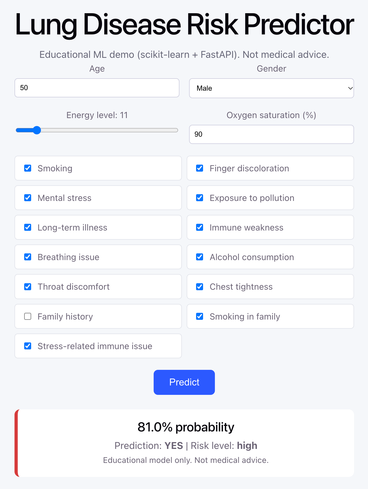
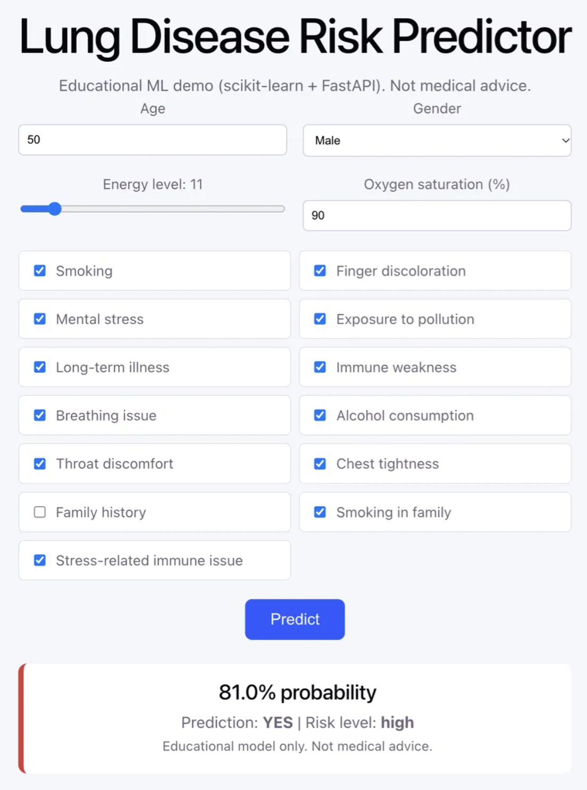

# Lung Disease Risk Predictor

An end-to-end machine learning project: a scikit-learn model served by a FastAPI backend, with a React frontend.

**Live demo:** https://lungs-cancer-ml.vercel.app
**API docs:** https://lungs-cancer-ml-efw1.onrender.com/docs

> **Disclaimer:** This is an educational project. It is not a medical device and must not be used for diagnosis or medical advice.

> The API runs on a free tier and sleeps when idle, so the first request can take about 30 seconds.

## Screenshots

| Low-risk example | High-risk example |
|---|---|
|  |  |

## What it does

The user fills in a form (age, gender, smoking, oxygen saturation, symptoms and so on). The frontend sends the values to the API, which validates them, runs the trained model and returns a probability, a YES/NO prediction and a low/medium/high risk level.

## Tech stack

- **Model:** scikit-learn (Pipeline with StandardScaler + Random Forest)
- **Backend:** FastAPI, Pydantic validation, Uvicorn
- **Frontend:** React (Vite)
- **Deployment:** Render (API), Vercel (frontend), GitHub

## Model and results

Dataset: 5,000 records, 17 input features, binary target (`PULMONARY_DISEASE`).

Three models were compared in the notebook (Logistic Regression, Decision Tree, Random Forest). The final pipeline in `backend/train.py` compares Logistic Regression and Random Forest using 5-fold stratified cross-validation and keeps the better one.

| Metric (held-out 20% test set) | Value |
|---|---|
| Accuracy | 0.90 |
| Precision (disease = YES) | 0.88 |
| Recall (disease = YES) | 0.88 |
| ROC-AUC | 0.925 |

Cross-validated ROC-AUC: Random Forest 0.925, Logistic Regression 0.924.

Most important features (Random Forest): smoking, energy level, throat discomfort, breathing issue, oxygen saturation, age.

## Project structure

```
backend/    FastAPI app, training script, saved model (model.joblib)
frontend/   React (Vite) app
            Colab notebook with exploration and model comparison
```

## Run locally

Backend:

```bash
cd backend
pip install -r requirements.txt
python train.py            # needs lungs_cancer.csv in this folder
uvicorn main:app --reload  # http://localhost:8000/docs
```

Frontend:

```bash
cd frontend
npm install
npm run dev                # http://localhost:5173
```

Set `VITE_API_URL` to point the frontend at a different API. On the server, set `ALLOWED_ORIGINS` to the frontend's URL.

## API

`POST /predict` takes the 17 features as JSON and returns:

```json
{
  "probability": 0.0367,
  "prediction": "NO",
  "risk_level": "low",
  "disclaimer": "Educational model only. Not medical advice."
}
```

`GET /health` returns `{"status": "ok"}`.

## Limitations

- The dataset appears to be synthetic or simplified, so results do not reflect real clinical performance.
- Some features are undocumented: the unit of `ENERGY_LEVEL` and the encoding of `GENDER`.
- No user data is stored.

## Possible next steps

- Docker and CI (GitHub Actions) with automated API tests
- Model explanation (SHAP) in the UI
- Threshold tuning to favour recall
